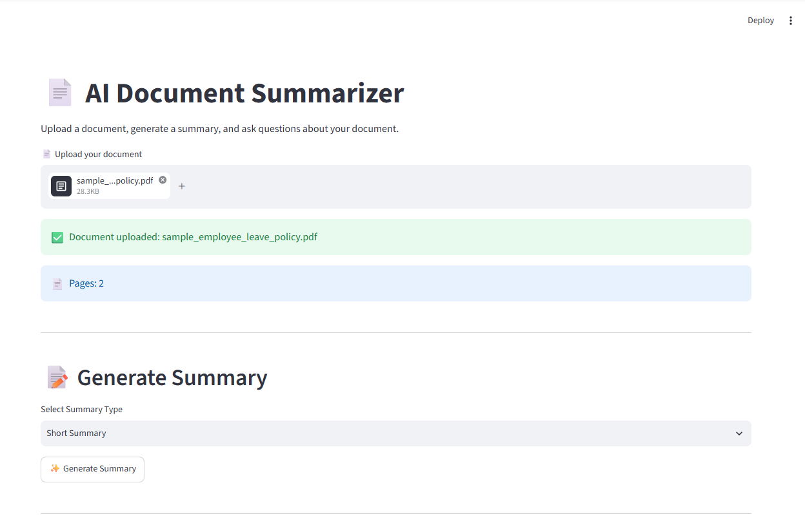
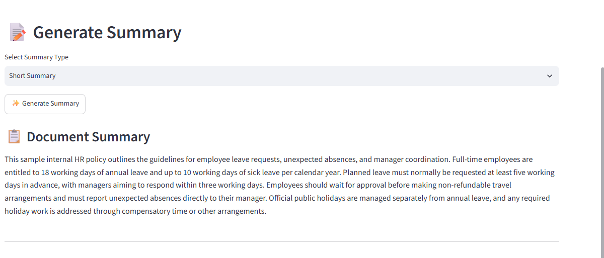
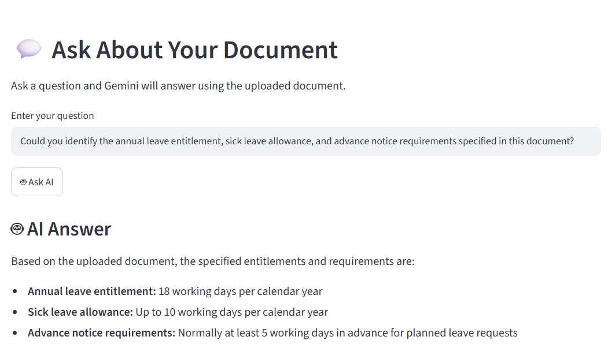
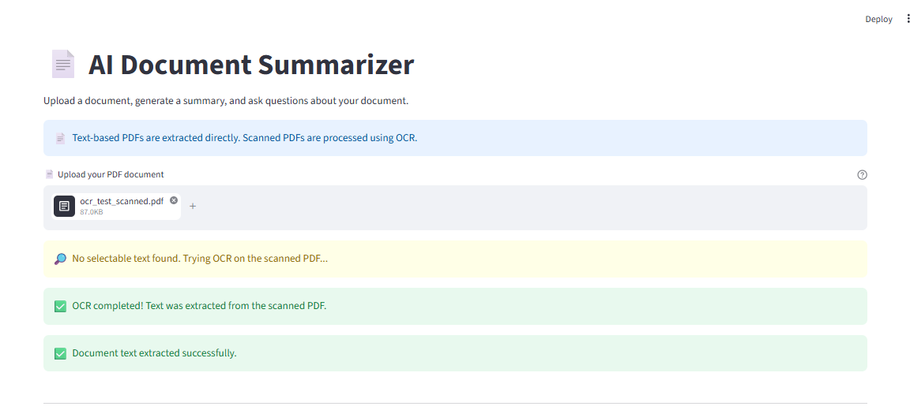
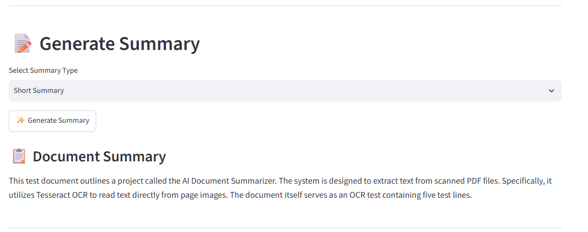

# 📄 DocuMind AI — Document Summarizer

An AI-powered document assistant that helps users summarize PDF files, ask questions about document content, and extract text from scanned PDFs using Optical Character Recognition (OCR).

Built with Python and Google's Gemini API, this project combines document processing and Generative AI to make information easier to understand.

## ✨ Features

- 📄 **PDF Upload and Text Extraction** — Read content from supported PDF documents.
- 🤖 **AI-Powered Summarization** — Generate summaries using the Google Gemini API.
- 💬 **Document Question Answering** — Ask questions about uploaded PDF content.
- 🔍 **OCR Support** — Extract text from scanned PDFs using Tesseract OCR.
- 📚 **Scanned PDF Summarization** — Generate summaries from OCR-extracted text.
- 🖥️ **Web Interfaces** — Includes Streamlit and Flask application components.

## 🛠️ Technologies Used

| Technology | Purpose |
|---|---|
| Python | Application development |
| Streamlit | Interactive document interface |
| Flask | Web application framework |
| Google Gemini API | AI-powered text generation |
| PyPDF | PDF text extraction |
| Tesseract OCR | Text recognition from scanned documents |
| pdf2image | Convert PDF pages into images |
| Poppler | PDF processing support for OCR workflows |
| Pillow | Image processing |

## 🖥️ Application Screenshots

### 1. Application Homepage



### 2. Generated Document Summary



### 3. Document Question and Answer



### 4. OCR Text Extraction from a Scanned PDF



### 5. AI Summary of a Scanned PDF



## 🚀 Getting Started

### Prerequisites

- Python installed on your computer
- A Google Gemini API key
- Tesseract OCR and Poppler for scanned-PDF processing

### 1. Clone the Repository

```bash
git clone https://github.com/chethansree77/ai-document-summarizer.git
cd ai-document-summarizer
```

### 2. Create a Virtual Environment

```powershell
python -m venv venv
```

Activate it in Windows PowerShell:

```powershell
.\venv\Scripts\Activate.ps1
```

### 3. Install Dependencies

```powershell
python -m pip install -r requirements.txt
```

### 4. Configure the Gemini API Key

Create a `.env` file in the project root directory and add your own API key:

```text
GEMINI_API_KEY=your_gemini_api_key_here
```

You can also copy `.env.example` to `.env` and replace the placeholder with your key.

**Security:** Never upload your real `.env` file or expose your API key in your source code.

### 5. Run the Streamlit Application

```powershell
python -m streamlit run streamlit_app.py
```

### 6. Configure OCR on Windows

For scanned-PDF OCR, install the required external tools:

- [Tesseract OCR for Windows](https://github.com/UB-Mannheim/tesseract/wiki)
- [Poppler for Windows](https://github.com/oschwartz10612/poppler-windows/releases)

Ensure the application can locate the installed executables, following the configuration used in your project.

## 🔐 Security

- Store API keys in environment variables.
- Keep `.env` files out of version control.
- Use `.env.example` to document required environment variables without including real secrets.

## 👩‍💻 Author

**Chethana Sai Sree**

[GitHub Profile](https://github.com/chethansree77)

## 📌 Project Highlights

This project demonstrates practical experience with:

- Python application development
- Generative AI integration using the Gemini API
- PDF processing and text extraction
- OCR-based document processing
- Building interactive web applications with Streamlit and Flask
- Environment variable management and GitHub project documentation
